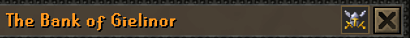

# My BiS Finder

My BiS Finder looks at your banked, equipped and inventory gear to recommend
loadouts for your chosen target. It compares Melee, Ranged
and Magic using your combat levels, available equipment and supported target
mechanics, then highlights the lowest estimated time to kill.

Calculations run locally in RuneLite using bundled OSRS Wiki-derived data.
You do not need to enter your bank into a separate calculator.

## Features

- Owned equipment, compatible ammunition and available runes.
- Slash, Stab, Crush, Ranged and Magic comparisons, with a **BEST** indicator
  and cached results for switching styles.
- Supported spells, offensive prayers, food, potions and Slayer supplies.
- Target defence, elemental weaknesses, immunities, weapon passives, enchanted
  bolt effects and multi-hit attacks.
- Current Slayer task alternatives, including differently named monsters and
  bosses, with location filtering for Konar and Krystilia.
- A bank view for finding recommended items and optional GIM shared storage.
- Persistent item exclusions and a statistics panel that expands for wrapped text.

## Getting started

Install **My BiS Finder** through RuneLite's Plugin Hub and open its sidebar.
This repository may include changes awaiting Plugin Hub review.

1. **Open your bank** to capture owned items. Equipped gear and inventory items
   are also considered.
2. **Choose a target**, or enable **Load Slayer Task** and select an alternative
   from your detected assignment.
3. Click **Generate Loadout** to calculate the supported combat styles.
4. Select **Slash**, **Stab**, **Crush**, **Ranged** or **Magic** to see its gear,
   estimated time to kill, sustained DPS, ammunition or spell, and prayer.
5. Open your bank and click the **My BiS Finder button** to find recommended
   equipment and supplies. Click it again to restore the normal bank layout.

The button appears in the upper-right corner of the bank interface. Gear icons
and validation appear once a target, bank scan and generated style are available.
Regenerate after changes to the target, assignment, ownership or calculation
options. Switching generated styles reuses the current results.

## Slayer tasks and locations

Enable **Load Slayer Task** to use your detected assignment. The dropdown lists
matching combat profiles and supported alternatives from the bundled catalogue.
For example, an unrestricted Greater demons task can offer Greater demons,
K'ril Tsutsaroth, Tstanon Karlak, Skotizo and Tormented demons.

- **Konar:** targets are filtered to the assigned area and its permitted species.
- **Krystilia:** targets are filtered to confirmed Wilderness variants.
- **Other masters:** task-family matching applies without an assigned-area filter.

The note below the picker shows the detected assignment location. If RuneLite
has not detected the task, check it with your Slayer gem, helmet or master.
Supported Slayer level requirements apply; quest access and special killing
requirements still matter.

Only confirmed targets appear for restricted assignments. Unknown variants stay
hidden with a note, and an undetected area keeps the picker empty. Named Konar
boss assignments without an area roll remain available. Task changes refresh the
choices and require regeneration. Disable task mode to return to manual search.

The current catalogue has confirmed targets for all **159 researched task/area
combinations**. The completed review resolves all **470 previously outstanding
location decisions**. These counts do not guarantee every possible game variant
is represented. Combat-data changes can require new verification. See the
[coverage report](SLAYER-LOCATION-COVERAGE.md) and
[Slayer data notes](SLAYER-DATA-NOTES.md).

## Item exclusions

Right-click a generated sidebar gear icon or a recommended item in the BiS bank
view and choose **Exclude from My BiS Finder**. Exclusions cover equipment,
ammunition, runes, food, potions and other supplies, including references to items
held in the other store. Ordinary bank items and **Other items** keep their usual menus.

Exclude several items before recalculating if needed. Existing results remain
visible, including when switching styles, and a warning asks you to regenerate.
The next generation applies the complete exclusion list.

Edit the comma-separated **Excluded items** field in RuneLite's plugin settings
to remove an exclusion, or clear the field to clear all exclusions. Regenerate
to restore eligibility. Names match exactly, ignoring case and surrounding
spaces. Potion doses and variants canonicalised by RuneLite are treated together.
Exclusions persist in the current RuneLite configuration profile.

Excluded supplies use supported owned alternatives where available. Excluded
runes block spells requiring them unless eligible equipment supplies those runes.
Powered weapons' stored charges are separate from loose rune ownership.

## Advanced options

Expand **Advanced** beneath the target to see available options. It starts
collapsed, and checked options appear green.

- **Include Ruby bolts (e)** appears when suitable bolts are owned in the checked
  ownership sources. Disable it to omit them from calculations.
- **Include group storage** appears on GIM accounts and is off by default.

Preferences persist across restarts. Changing an option requires regeneration;
storage updates do not automatically recalculate loadouts.

## Group Ironman shared storage

Open your personal bank, enable **Include group storage**, then open group
storage to capture its contents. The sidebar shows the shared snapshot's scan
time. Generate a loadout and select a combat style as usual.

The My BiS Finder button is available in both storage interfaces. Recommended
items in the open store retain normal withdrawal actions. Items held elsewhere
appear under **Stored in group storage** or **Stored in personal bank**. These
reference icons show where to find an item; open that store to withdraw it.
Recommended supplies can span both stores.

Shared gear, ammunition, runes, food and potions are included when enabled.
Deposits and withdrawals update the snapshot while storage is open. Changes
made by teammates may require reopening it. Scan both stores after logging in:
snapshots are session-only, while preferences and exclusions persist.

## Understanding the results

Time to kill and DPS are estimates for the supported combat model. The optimizer
compares sustained attacks; it does not plan a full encounter strategy or
special-attack rotation. Movement, downtime and mechanics outside the model can
affect actual results.

Recommendations depend on captured ownership data and supported account unlocks.
Reopen storage and regenerate when something changes. New items, monsters or
mechanics may need a data or code update.

## Privacy and data updates

Account, bank and loadout processing stays on your computer. The plugin does
not transmit account or bank data or make external network requests.

Combat data ships with the plugin. Repository automation checks published
upstream data and proposes reviewed updates. Installed plugins receive changes
through releases, rather than live Wiki downloads. See the
[update documentation](scripts/WIKI-UPDATES.md).

## Development and testing

The project compiles for Java 11 and uses RuneLite `latest.release`. Open the
source folder in IntelliJ, reload Gradle and run the Gradle **run** task for the
development client. Disable the installed Plugin Hub copy while testing it.

The [testing guide](docs/TESTING.md) covers automated verification and in-game
checks. Data provenance and regeneration instructions are recorded in the
Slayer data notes and scripts documentation. Historical combat-math work remains
in the [Wiki DPS parity notes](WIKI_DPS_PARITY.md).

## Licence and development disclosure

Plugin source is provided under the [BSD 2-Clause License](LICENSE). Bundled
data provenance is recorded in [WIKI-DATA-NOTES.txt](WIKI-DATA-NOTES.txt), the
data manifest and the Slayer data notes. Third-party notices remain alongside
the relevant resources.

My BiS Finder was developed with substantial assistance from AI coding tools.
The maintainer reviews and tests releases before submission to Plugin Hub;
releases remain subject to its review process.

See the [changelog](CHANGELOG.md) for version history.
